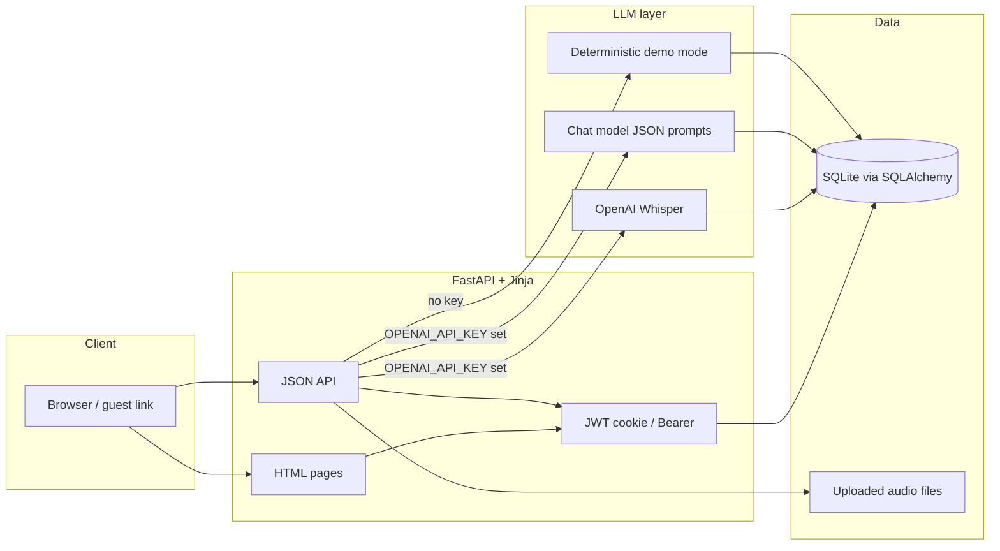
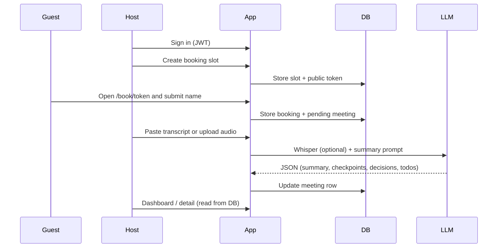
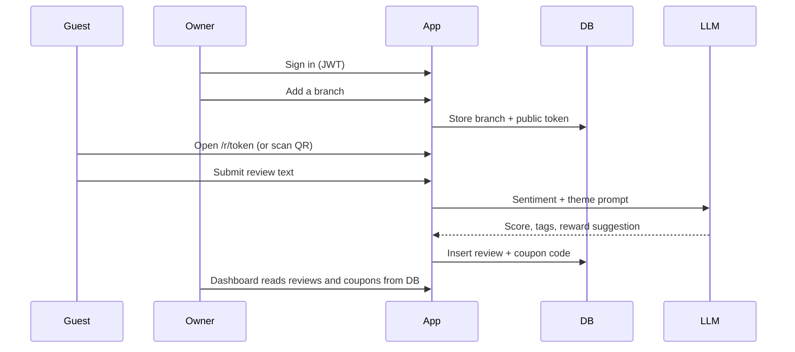
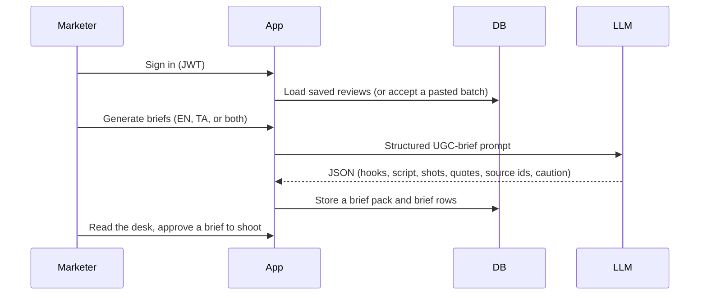
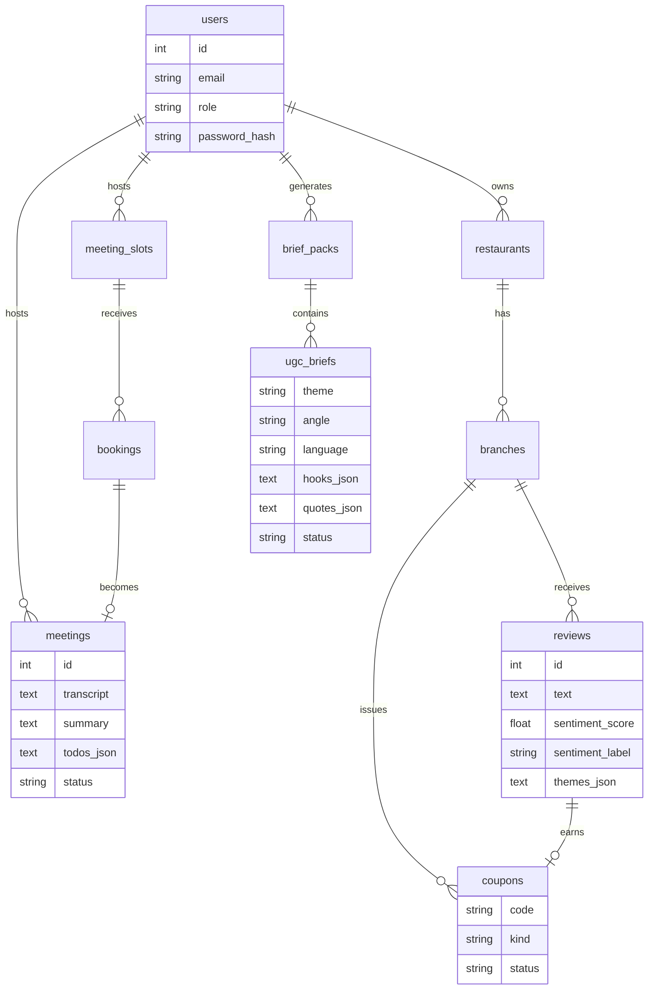

# AI Workbench — Book & Record, Review Rewards, and Review to Reel

Three small, interview-ready web apps in one FastAPI project:

1. **Book & Record** — a meeting host signs in, creates a public booking link (Calendly-style), then pastes a transcript or uploads audio. The app transcribes with OpenAI Whisper (or a demo stand-in), asks a chat model for a structured summary, and stores checkpoints, decisions and a to-do list with owners in SQLite.
2. **Review Rewards** — a restaurant owner signs in, adds branches, and gets a public review link plus a QR code for each branch. A guest submits a review. The app scores sentiment, tags food / service / wait, issues a coupon or cashback code, and the owner dashboard reads all of that back from the database.
3. **Review to Reel** — a creative desk that turns those reviews (or a pasted batch from Google / Zomato / a clinic) into shoot-ready 15-second UGC briefs for Meta / Instagram Reels: one idea per brief, hook options, a shot list, on-screen text, a CTA, verbatim guest lines with source review ids, in English and Tamil. A person approves a brief before it is marked ready to shoot.

This is a personal portfolio project. It is a working application with JWT authentication, a real database, and a path to a public URL. It is not a production SaaS, and no live user or revenue numbers are claimed.

**Live demo:** _to be added after Render deploy_  
**GitHub:** _to be added after the repo is pushed_

---

## Architecture



**Book & Record flow**



**Review Rewards flow**



**Review to Reel flow**



---

## Stack (what is actually in this repo)

| Layer | Choice | Why |
| --- | --- | --- |
| Language | Python 3.12+ | Common for junior Gen AI roles, easy to explain |
| Web | FastAPI, Jinja2 templates, one CSS file | HTML you can click through, plus a JSON API for tests |
| Auth | JWT (PyJWT) in an httpOnly cookie, or `Authorization: Bearer` | Same token for the browser and the API |
| Passwords | PBKDF2-HMAC-SHA256 (stdlib) | No extra hashing library to break on deploy |
| Database | SQLite via SQLAlchemy 2 | A real relational store; dashboards query it, they do not hard-code rows |
| LLM | OpenAI chat + Whisper when `OPENAI_API_KEY` is set | Structured JSON prompts, not a chat toy |
| Fallback | Deterministic demo mode | The full path works without a paid key |
| QR | `qrcode` + Pillow | Each branch has a scannable link |
| Deploy | `Dockerfile`, `render.yaml`, `Procfile` | One-command deploy on Render’s free web service |

No LangChain, no vector database, and no n8n in this project. Those are not listed as skills for this work.

---

## Auth flow

1. Sign up or sign in with email and password. The password is stored as a PBKDF2 hash, never in plain text.
2. The server builds a JWT with `sub` (user id), email, role (`host` or `owner`), issued-at and expiry, signed with `JWT_SECRET` (HS256).
3. The token is returned in the JSON body and also set as the `access_token` httpOnly cookie (`SameSite=Lax`).
4. Protected pages and `/api/*` routes read the cookie or the `Authorization: Bearer` header, verify the signature and expiry, then load the user from SQLite.
5. Data is scoped to that user: a host only sees their meetings; an owner only sees their restaurant. Guest booking and review pages are public, by token, and do not require login.

---

## Prompts (the exact instructions sent to the model)

When an API key is present, these strings in `app/llm.py` are the system prompts. The user message is the transcript or the review text. The model is asked for JSON only (`response_format: json_object`). If the call fails, demo-mode logic is used as a fallback so the request still finishes.

**Meeting notes**

```
You are a careful meeting-notes assistant.
Read the transcript and return ONLY valid JSON with this shape:
{
  "summary": "3 to 6 sentences covering what was discussed and why it matters",
  "checkpoints": [{"item": "short status or milestone", "status": "decided|open|blocked"}],
  "decisions": ["a decision the group actually made"],
  "todos": [{"task": "clear action", "owner": "name or unspecified", "due": "date or unspecified"}]
}
Rules:
- Use only facts present in the transcript. Do not invent attendees, numbers or deadlines.
- If an owner or due date is not stated, use "unspecified".
- Prefer short, concrete wording a busy manager can scan.
- If the transcript is empty or unusable, say so in the summary and return empty lists.
```

**Restaurant review**

```
You are scoring a restaurant guest review so the owner can see branch-level sentiment.
Return ONLY valid JSON with this shape:
{
  "sentiment_score": 3.0,
  "sentiment_label": "positive|neutral|negative",
  "themes": {"food": "pos|neu|neg|na", "service": "pos|neu|neg|na", "wait": "pos|neu|neg|na"},
  "themes_note": "one short sentence on why you tagged it that way",
  "coupon": {"kind": "coupon|cashback|none", "value_text": "10% off next visit"}
}
Rules:
- sentiment_score is a number from 1.0 to 5.0.
- Tag a theme "na" if the review does not mention it.
- Reward genuine reviews, including critical ones. Do not reward empty, spam or one-word reviews (kind=none).
- Typical reward: "10% off next visit". Use a small cashback (for example "₹50 cashback") only for a detailed, constructive review.
- Never increase a score because the guest asked for a discount.
```

**UGC briefs (Review to Reel)**

The full system prompt lives in `app/llm.py` as `BRIEF_SYSTEM_PROMPT`. In short: one idea per brief; use only wording in the reviews; attach source review ids; write Tamil separately when asked; if guests complained about a wait, write an objection brief with a caution — never invent a “no wait” claim; never offer a discount in exchange for a review.

Demo mode clusters reviews with theme dictionaries (food, service, wait, value, ambience) and fills English or Tamil templates. It is deterministic, and it still attaches the real quotes.

Demo mode for meetings and reviews does not call the API either. It uses keyword rules (positive/negative words and theme dictionaries) so a recruiter can still click through.

---

## Data model



Defined in `app/models.py`. Dashboards issue ordinary SQLAlchemy queries (`filter`, `order_by`, averages in Python for branch scores).

---

## Run locally

```bash
python3 -m venv .venv
source .venv/bin/activate
pip install -r requirements.txt
# optional: cp .env.example .env   and add OPENAI_API_KEY
uvicorn app.main:app --reload --host 0.0.0.0 --port 8000
```

Open [http://127.0.0.1:8000](http://127.0.0.1:8000).

**Demo logins** (seeded on first boot if the database is empty):

| Role | Email | Password |
| --- | --- | --- |
| Meeting host | `host@demo.local` | `demo1234` |
| Restaurant owner | `owner@demo.local` | `demo1234` |

The owner dashboard is pre-loaded with **Spice Garden** (Koramangala and Indiranagar), a few reviews plus coupon codes, and a **Review to Reel** pack already generated from those reviews (English and Tamil). The host desk has a processed sample meeting and an open booking slot. A host can also paste reviews into Review to Reel without owning a restaurant.

Smoke test (always uses its own empty SQLite file and demo mode):

```bash
python tests/smoke_test.py
```

API docs while the server is running: [http://127.0.0.1:8000/api/docs](http://127.0.0.1:8000/api/docs).

---

## Deploy on Render (free web service)

1. Push this folder to a GitHub repository (do not commit `.env` or `data/*.db`).
2. In [Render](https://render.com), create a new **Web Service** from that repo, or use the Blueprint with `render.yaml`.
3. Settings that already live in this repo:
   - Build: `pip install -r requirements.txt`
   - Start: `uvicorn app.main:app --host 0.0.0.0 --port $PORT`
   - Health check: `/health`
   - Or build from the `Dockerfile`.
4. Set environment variables:
   - `JWT_SECRET` — a long random string (Render can generate this).
   - `OPENAI_API_KEY` — optional. Leave unset to keep demo mode.
5. After the first deploy, open the public URL, sign in with the demo users (a fresh SQLite file is created on the instance), and put that URL plus the GitHub link on the resume.

**Note on the free plan:** the SQLite file lives on the instance disk and will be reset when the instance is recycled unless you attach a persistent disk. That is acceptable for a demo. For a longer-lived demo, attach a Render disk and point `DATA_DIR` at it, or switch `DATABASE_URL` to a free Postgres later.

---

## Project layout

```
app/
  main.py          # HTML pages + JSON API
  models.py        # SQLAlchemy tables
  auth.py          # PBKDF2 + JWT
  llm.py           # Prompts, OpenAI calls, demo mode
  seed.py          # Demo users and sample rows
  templates/       # Jinja pages, including briefs/
  static/style.css
tests/smoke_test.py
scripts/take_screenshots.py
Dockerfile  render.yaml  Procfile
INTERVIEW_NOTES.md
```

Built as a portfolio project for Ajith Selvaraj (Bengaluru).
